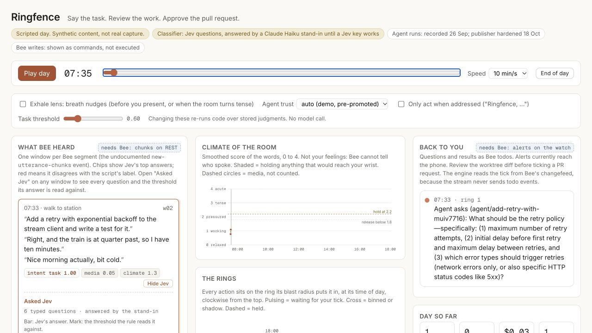
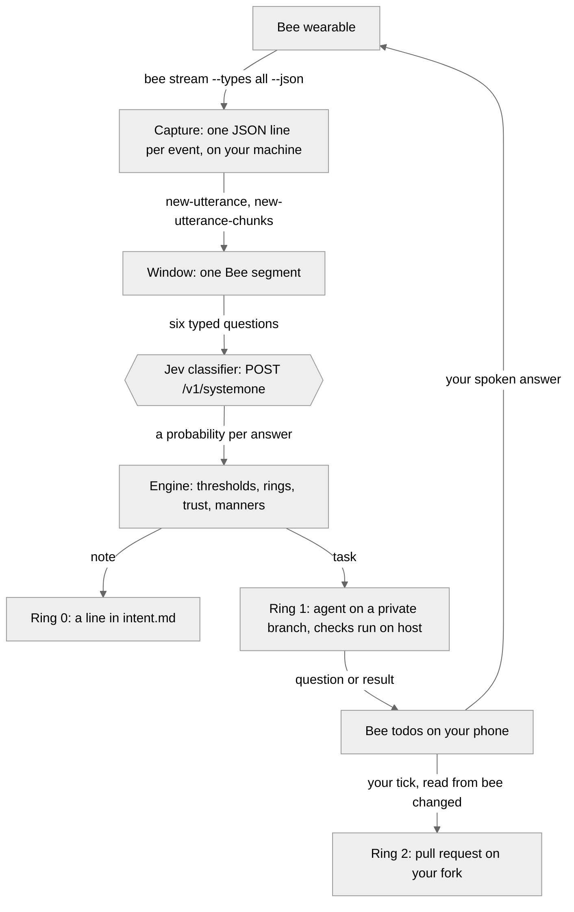

# Ringfence

Say the task. Review the work. Approve the pull request.



You talk through your day wearing Bee. When Ringfence hears an idea, it writes it down. When it hears a task, it starts a coding agent on its own branch. When the agent needs a decision, the question arrives as a Bee todo and you answer out loud. When the work is ready, a checked branch waits for review and your tick to open a pull request. Nothing is committed, pushed or opened as a pull request until you tick.

What does travel before that: each window's words go to the classifier, the agent's work goes to Claude, and questions and results arrive as Bee todos.

A classifier estimates what was said using typed questions and probabilities. The public demo uses a labelled Claude Haiku stand-in for the [Jev](https://docs.typesafe.ai) interface; the Jev adapter is available but has not been validated here. What may happen is decided by code you can read. You draw the rings in [`src/engine/policy.ts`](src/engine/policy.ts): which action sits on which ring, and the threshold each one needs.

Built for the Amazon App Dev Hackathon 2026, Bee track.

**Try it without Bee, accounts, API keys or paid calls:** with Node 24+, run `npm ci --ignore-scripts` then `npm run dev`. Open http://localhost:5188. The scripted replay uses synthetic speech and recorded agent runs; its buttons never run agents or publish anything. Live use needs Bee and authenticated command-line tools.

[Submission draft](devpost-submission.md) · [Audit and readiness](docs/audit-2026-10-18.md) · [Public friction summary](docs/friction-log.md) · [Demo script](demo/script.md)

## The idea: make being wrong cheap

A wearable hears everything, and speech is ambiguous. "We should rewrite that parser" can be an opinion or an instruction. Ringfence does not try to guess intent perfectly. It bounds what a wrong guess can cost.

| Ring | What it may do | When it runs | Cost of a wrong guess |
|---|---|---|---|
| 0 · acts on you | A note in a private `intent.md` | Automatically | One line in a file |
| 1 · private branch | A coding agent in its own git worktree, on its own branch. It plans with read-only tools, then builds with file tools only: the agent has no shell. Ringfence then runs the repo's checks on its code, without your keys | Automatically in the demo, where ring 1 is set to auto. Shadow mode is available in the replay; live execution requires `--execute` | Measured: US$0.07 to US$0.30 a run, and a branch you delete. A run with nothing to review is binned. Checks execute code on your host; use a disposable checkout with no sensitive files |
| 2 · publish | Commit, push, pull request | Only after you tick the Bee todo | Nothing until you tick |

Three more rules keep your attention cheap:

- While the talk around you reads tense, anything bound for your wrist waits.
- An answer resumes an agent only if Jev matches it to that agent's open question. An answer to a different question is ignored.
- A fragment that only makes sense as a reply ("five attempts, go ahead") never starts new work. An agent starts only for a request that names what to change.

## How it uses Bee

| Bee surface | What Ringfence does with it |
|---|---|
| `bee stream`, through a capture daemon | Reads utterances as they arrive |
| `new-utterance-chunks` (undocumented stream event) | One window per Bee segment, with Bee's own one-line summary as context for the agent |
| Todos, via `@beeai/cli/lib` | Agent questions, branch results, pull request requests (alerts currently reach the phone) |
| The changefeed, `changed` | Approvals. The stream never sends todo events, so ticks are read here |

## How it decides: Jev

### Architecture



The classifier is the only model in the admission decision path. Each window gets six typed questions, and a seventh while an agent waits for an answer:

| Question | Jev type | Rule that reads it (`policy.ts`) |
|---|---|---|
| `intent`: none, note or task | choice | task at 0.6 or more starts ring 1; note at 0.5 or more writes ring 0 |
| `task_line`: which utterance states the request | choice | that line becomes the agent's task |
| `task_self_contained`: does it name what to change | noul | under 0.5 is a fragment and never starts work |
| `media`: is this media playing nearby | noul | 0.6 or more is skipped, and not counted in the climate |
| `climate`: how tense is the live speech | score, 5 levels | smoothed; results bound for your wrist wait at 2.2, go out below 1.8 |
| `performance`: about to present within the hour | noul | 0.7 or more sends a breath nudge; so does the room first turning tense (off until Bee alerts reach the watch) |
| `answer_to`: which open question does this answer | choice | 0.7 or more within 90 minutes resumes that agent, even when `intent` says task |

`choice` picks one option, `noul` gives the probability of a yes, and `score` rates on a scale (0 to 4 here).

TypeSafe says its System One models are trained for calibrated decisions, and advises validating them on your own data. Until a Jev key works, a labelled Claude Haiku stand-in answers the same request with the same response shape, so the engine never knows which judge ran. `scripts/judge-bench.ts` sends the same 17 requests to either judge and reports accuracy, stability across repeats, latency and cost. The stand-in's result is the bar Jev has to clear: on three runs of each request, 5 of 17 windows changed their decision between runs, and one window scored media 0.04, 0.00, then 0.99 (`fixtures/bench.standin.json`).

### Media is untrusted input

A wearable also hears the room. On 25 September 2026 at 06:45, a YouTube Short on a nearby phone spoke instructions aimed at an AI agent ("Look at my entire Facebook and Instagram history…"), and Bee transcribed them like anything said in person. Bee's own summary called the audio "background entertainment", and its action-item extractor still turned a song into a to-do. Put through the Jev questions (answered by the stand-in, see above), the video's prompt was stopped three times over: media at 0.70 against a 0.6 cut-off, intent "none" at 0.85, and self-contained at 0.15. The media score is the weakest of the three, which is why the rings matter. If the classifier is wrong, an agent can still start and its checks can execute on the host. The separate publication gate prevents an automatic push; it does not isolate host execution.


## What Amazon could ship

Ringfence is a vision, and parts of it lean on things Bee does not do yet. The dashboard marks each one with a "needs Bee" tag and lists them in a panel, with how many moments in the day depend on each.

| Request | Bee today | What it unlocks |
|---|---|---|
| Send todo events on the stream | Listed as event types, never delivered. A tick shows up only by polling the changefeed, about 35 s later | Your tick opens the pull request at once |
| Deliver todo alerts to the watch | An alarm todo buzzed the phone and never the watch, whether the phone was in use or locked. One check is open: the Watch app's mirror setting for Bee | Questions and results arrive on the wrist, and so can a breath before you present. The breath nudge exists (the Exhale lens) and waits for this |
| Tag chunks that come from media | Bee's own summary called 31 minutes of songs "background entertainment audio", yet all 15 chunks were tagged `CONVERSATION` | Put what the summary knows into the tags, and a video playing nearby can be skipped by policy |
| Identify the wearer at real-world scale | 10,336 of 10,336 utterances came back `Unknown` | Act only on the wearer's own words |
| Serve chunks over REST, with a replay cursor | Segments exist only on the stream, which dies after about 43 h with no replay | No lost segments, no capture daemon |

A [public friction summary](docs/friction-log.md) records the observations without private transcripts; the original detailed log stays local. These are September measurements, not claims about the current Bee service. Two related fixes are open upstream: the stream client reconnecting instead of exiting, [bee-computer/bee-cli#16](https://github.com/bee-computer/bee-cli/pull/16), and usage text kept out of stdout on errors, [bee-computer/bee-cli#17](https://github.com/bee-computer/bee-cli/pull/17).

## Run it

Needs Node 24 or newer (the scripts run TypeScript directly; tested on Node 26.7), and for live mode `bee`, `claude` and `gh` logged in, plus `bun` for the Bee CLI's checks.

```bash
npm ci --ignore-scripts
npm run dev                      # dashboard on http://localhost:5188, replaying a scripted day
npm run check                    # judge against the script's labels, then the day as a log
npm run live -- --standin       # live, dry run: reads the capture files in ~/.bee-capture; drop --standin once a Jev key is in .env
npm run live -- --standin --execute --repo ~/code/your-fork   # agents really run; add --effects to write Bee todos (they can buzz your phone)
# then open http://localhost:5188/?live to watch the day unfold on the dashboard
node scripts/probe-todo.ts       # does an alarm todo buzz, and how fast a tick reaches the changefeed
npm test                         # offline engine, classifier validation and real-Git runner regressions
scripts/up.sh --standin          # capture, dashboard and live mode in one command; Ctrl+C stops all three
```

[TESTING.md](TESTING.md) has a 20-minute live test that walks every path, and the shadow-day replay: a real day through the engine with every action off.

While live mode runs, the dashboard at `/?live` follows it: windows as Bee segments them, agent questions and results, pull request requests waiting for your tick in the Bee app. Live mode serves its state on `127.0.0.1:5189`, and only to the dashboard's own origin, because the state holds real speech. To rehearse without the watch, replay a file and keep serving: `node scripts/live.ts --standin --execute --repo <path> --from <events.jsonl> --stay`.

Live mode never opens `bee stream` itself. A separate capture daemon writes raw events, one JSON object per line as `bee stream --types all --json` prints them, to `*.jsonl` in `$BEE_CAPTURE_DIR` (default `~/.bee-capture`). Ringfence reads the newest file and keeps its own log and notes in `$BEE_CAPTURE_DIR/ringfence/`. Both hold real speech, so both stay outside every git repo.

To use Jev instead of the stand-in judge, put a key in `.env` (see `.env.example`): either `TYPESAFE_API_KEY`, or `AI_GATEWAY_API_KEY` to reach Jev through Vercel AI Gateway's TypeSafe-compatible endpoint. Then run `npm run judge` and `npm run check jev`.

## Agents for real (`--execute`)

`src/runner.ts` runs one agent at a time. For each task it adds a git worktree under `~/.ringfence/worktrees` on a unique `agent/<task>-<id>` branch, then:

1. **Plans** with `claude -p --restricted --tools Read,Grep,Glob`. Restricted mode ignores settings files, so a hook the agent writes into the repo never runs. The prompt carries the task, Bee's segment summaries from the 10 minutes before it, and the real shape of any Bee event the task names, as seen on the stream with values redacted. The agent is told to ask rather than guess an outside format.
2. **Asks or builds.** A plan that ends with `QUESTION:` becomes a Bee todo, and your spoken answer resumes the same session. A plan that asks nothing goes straight to building.
3. **Builds** with `--tools Read,Grep,Glob,Edit,Write`. Nothing is committed.
4. **Checks.** Ringfence, not the agent, runs the repo's checks. On failure the agent gets the output once to fix the cause, then the checks run again. A branch that still fails reaches the wrist as a result, never as a pull request request (`RINGFENCE_CHECK`; for the Bee CLI `bun install --ignore-scripts && bun run typecheck && bun run build && bun test`). The wrist todo leads with the verdict: "checks pass" or "CHECKS FAIL". The checks run the agent's code as you, with keys and tokens stripped from their environment; files you can read, they can read. Point Ringfence at repos you would let a contractor run tests on.
5. **Ring 2, on your tick only.** Asks GitHub whether `origin` is a fork and refuses if it is not. Requires successful configured checks. It checks the entire PR diff for workflow, Claude, hook, submodule and environment files, and verifies that fetch and push identify the same GitHub fork. The tick covers the completed Git tree: changed files, new commits or check-created changes require a fresh run and review. It reruns the checks, commits with Git hooks disabled, pushes the exact commit to the `agent/*` ref at the verified URL, and opens the PR on that fork. Branch names, commit messages and PR titles use a generated ID rather than the spoken task. It never pushes upstream or to `main`, and failed checks mean nothing is committed.

Why the grounding exists: in a rehearsal on the Bee CLI, an ungrounded agent asked to render `new-utterance-chunks` invented a payload format, documented it in the README, and passed every check. Bee does not document the event, so nothing in the repo could contradict the guess. Grounded with the observed shape, the agent used the real fields.

Admission limits: 3 starts an hour and a US$5 daily threshold checked before each agent pass (`RINGFENCE_MAX_USD_PER_DAY`), 10 minutes a pass. Model: `RINGFENCE_MODEL`, default `haiku`. A pass can cross the threshold; classifier calls and costs from failed or interrupted passes are not included. This is not a hard billing ceiling. Every run is recorded in `$BEE_CAPTURE_DIR/ringfence/runs.json`. Worktrees avoid paths with spaces: given one, the model escaped the space in its file paths and every read was denied.

Tested end to end on 26 September 2026 on a fork of `bee-cli`, from a replayed stream with the full checks (`bun` typecheck, build and tests):

| Path | What happened |
|---|---|
| Task, no question | Grounded with the observed event shapes, planned and built in 72 s for US$0.26. Checks pass, 2 files changed. It used the real `chunks[].chunk_text` fields |
| Task, question | Asked "What is the heartbeat interval (in seconds)?" after 18 s (US$0.04). The spoken answer matched that question at p 0.95 and resumed the same session: built in 26 s (US$0.08), checks pass, and the code used the 30 s and stderr the answer asked for |
| Tick | Ring 2 printed the pull request it would open on the fork, never upstream (a replay is always a dry run) |

On 25 September, on the same fork, an agent planned the stream-reconnect fix, asked whether to retry forever, and built a version that typechecked and built. Review found it broke Ctrl+C. That is why ring 2 waits for a person.

## Evidence

One real day at home (25 September 2026) was replayed through the engine with every action off (`scripts/shadow-day.ts`): 6 conversations, 76 windows, 596 lines. 43 windows were skipped as media, 1 became a note, and 1 would have started an agent: the demo task read aloud at 21:59. No other window reached 0.3 for task, so the result holds for any task threshold from 0.5 to 0.9. Judging the day with the stand-in cost US$2.76. The full report quotes speech, so it stays on the laptop.

### What is real in the demo data

| Part | Status |
|---|---|
| Scripted day: 17 windows, 50 utterances, a fictional co-builder | Synthetic, public content, `fixtures/day.script.json` |
| Bee event shapes | Match the live stream as recorded in the friction log |
| Judgments | Claude Haiku standing in for Jev, labelled on every screen. Six questions per window, seven while an agent waits |
| Two agent runs | Recorded on 26 September with the runner as it stood then on a synthetic scratch repo: the retry task asks a question and resumes (US$0.11), the export task builds straight away (US$0.07). Both pass their checks |
| A reply that sounds like a task at 09:22 ("Let's just log it in the friction log") | Stopped by the fragment gate: self-contained 0.15 |

## Safety boundary

A Git worktree separates changes from your main checkout. It is **not an OS sandbox**. The agent's file tools are restricted, but the configured checks execute repository code with your host permissions. Key-like environment variables are stripped; files in your home directory and network access are not isolated. Use a disposable account or VM for untrusted repositories or unattended experiments. Speech and context go to the classifier and coding model; Bee todos go to your Bee account before any PR approval.

Read the local diff before ticking. The file list and tree fingerprint in the approval todo identify the completed result, not a security verdict. A fork check does not prove repository ownership, and a push can trigger workflows already installed on that fork. The dashboard records approval; the live terminal records whether publication succeeded or was refused. Publication and checks assume trusted Git configuration and no concurrent local process changing the worktree.

## Status and limits

- The judge is a stand-in until a Jev key works, and it is unstable: see the benchmark above.
- Speakers are not identified (Bee returns `Unknown`), so a colleague's words can start work too. The rings bound what that costs.
- The dashboard shows either the scripted day or live mode (`/?live`). It has no history view of past live days.
- A restarted live process does not resume old runs.
- Grok Build is a planned second agent target and is not wired in.

## Layout

- `src/engine/`: pure TypeScript shared by the dashboard, the scripts and live mode. `questions.ts` builds the judge request, `policy.ts` holds the rings, `engine.ts` replays windows into events.
- `src/judge/`: the Jev HTTP client and the labelled stand-in.
- `src/bee.ts`: the todo and changefeed calls, through `@beeai/cli/lib`. `scripts/shadow-day.ts` and `scripts/todos.ts` use the same library directly.
- `src/runner.ts`: ring 1 and ring 2.
- `src/ui/`: the dashboard.
- `scripts/`: fixture builder, judge runner, judge benchmark, rehearsal builder, check, live mode, probe, shadow day, todo list, and `up.sh` / `down.sh` / `capture.sh`.
- `test/`: engine rules and the agent runner, with a fake `claude`.

## Licence

MIT
